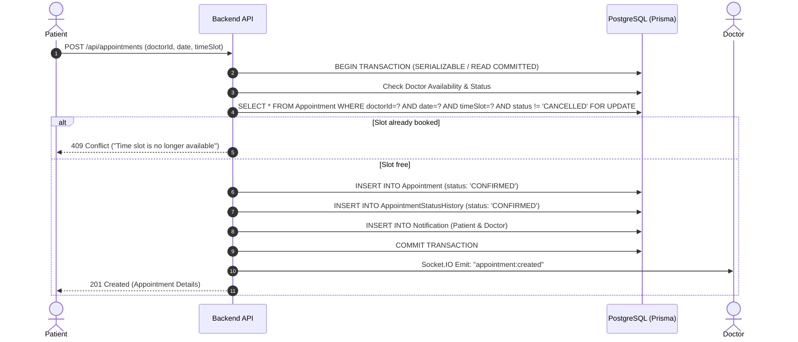
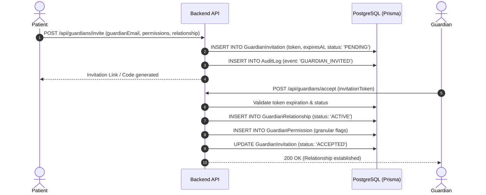
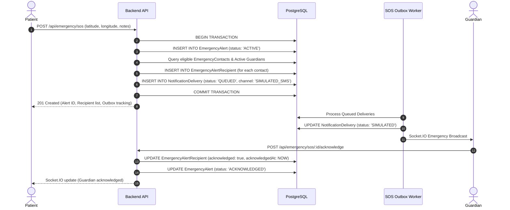

# CareBridge — System Architecture Document

**Version:** 2.0.0 (PostgreSQL + Prisma Migration)  
**Status:** Approved Architecture

---

## 1. High-Level Architecture Overview

CareBridge is built as a modular, decoupled full-stack architecture prioritizing security, clinical data isolation, ACID transactional consistency, and local privacy-preserving AI assistance.

```
                              +-------------------------------------------------+
                              |                 CLIENT LAYER                    |
                              |  React 18 + Vite + Tailwind CSS + Lucide Icons  |
                              |       Role-based Dashboards (4 Roles)           |
                              +-----------------------+-------------------------+
                                                      |
                                                      | HTTPS / REST & WebSocket
                                                      v
                              +-------------------------------------------------+
                              |                 BACKEND API                     |
                              |             Node.js + Express.js                |
                              |   Auth, RBAC/ABAC, Controllers, Services        |
                              |   Centralized Error Handling & Rate Limiting   |
                              +--------+------------------+---------------------+
                                       |                  |
                          Prisma Client|                  | HTTP / REST
                         (Connection   |                  | Internal IPC
                            Pool)      |                  |
                                       v                  v
                   +-----------------------+    +-----------------------+
                   |    DATABASE LAYER     |    |      AI SERVICE       |
                   |     PostgreSQL 18     |    |    Python FastAPI     |
                   |  Relational Storage   |<---+  Local Embeddings /   |
                   |   ACID Transactions   |    |    Ollama LLM Runtime |
                   |  Double-Booking Locks |    |  Deterministic RAG    |
                   +-----------------------+    +-----------------------+
```

---

## 2. Core Subsystems

### 2.1. Frontend Web Client (`/client`)
- **Technology:** React 18, Vite, React Router v6, Tailwind CSS, Lucide React, Axios.
- **State & Context:**
  - `AuthContext`: Centralized JWT token handling, authenticated user profile, and role state.
  - `NotificationContext`: Real-time toast alerts, in-app notification center, unread counters.
  - `SocketContext`: Bi-directional Socket.IO connection for real-time messaging, SOS triggers, and appointments.
- **Role Isolation:** Dynamic route guards (`ProtectedRoute`) enforcing client-side navigation boundaries, complemented by server-side authorization on every endpoint.

### 2.2. Backend API Service (`/server`)
- **Technology:** Node.js (ES Modules), Express.js, Prisma ORM, Socket.IO, Multer, Helmet, CORS.
- **Key Modules:**
  - `routes/` & `controllers/`: Clean separation of HTTP routing, validation, and business logic.
  - `middleware/`:
    - `authMiddleware.js`: Bearer token validation and user identity hydration.
    - `roleMiddleware.js`: Role enforcement (`PATIENT`, `DOCTOR`, `GUARDIAN`, `ADMIN`).
    - `rateLimiter.js`: Sliding-window rate limiting on sensitive routes.
    - `errorMiddleware.js`: Standardized JSON error response formatting without stack trace exposure.
  - `services/`:
    - `appointmentService.js`: Transactional booking and slot conflict detection.
    - `guardianService.js`: Expiring token invitation, acceptance, and granular permission enforcement.
    - `emergencyService.js`: Durable SOS alert creation, contact matching, and outbox delivery dispatch.
    - `triageService.js`: Algorithmic clinical symptom evaluation and doctor specialization recommendation.

### 2.3. Persistence & Relational Layer (`/server/prisma`)
- **Technology:** PostgreSQL 18 with Prisma ORM.
- **Key Capabilities:**
  - Strong foreign key constraints with indexed lookup fields.
  - Composite unique indexes (e.g. `[doctorId, date, timeSlot]`) preventing concurrent appointment collisions.
  - Relational mapping across clinical encounters, prescriptions, and status histories.
  - Comprehensive audit logging and security event tracking.

### 2.4. Local AI & RAG Service (`/ai-service`)
- **Technology:** Python 3.11, FastAPI, Uvicorn, Sentence-Transformers / Ollama client.
- **Workflow:**
  1. Ingestion: Curated, verified medical and first-aid reference guides chunked and indexed.
  2. Query Engine: Semantic similarity matching using cosine similarity over embeddings.
  3. Context Augmentation: Retrieved snippets injected into a structured, guard-railed prompt.
  4. Response Generation: Strict safety disclaimer, explicit source citations, and deterministic fallback when local LLM is offline.

---

## 3. Key Interaction Workflows

### 3.1. Concurrency-Safe Appointment Booking


### 3.2. Guardian Invitation & Consent Delegation


### 3.3. Persistent Emergency SOS & Notification Outbox

